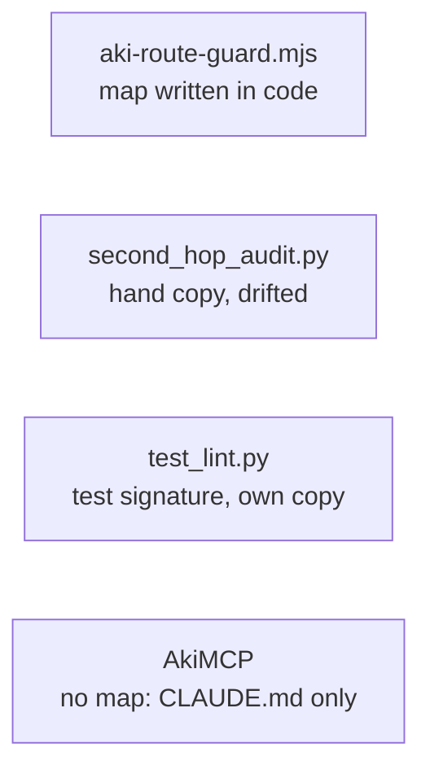
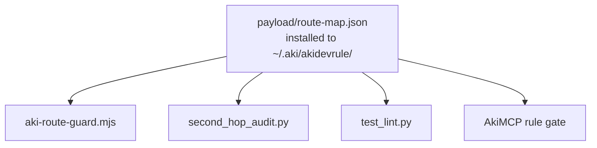

# Plan — one route map as data: `payload/route-map.json`

Status: executed 2026-10-20 (CHANGELOG 3.8.0). Two deviations from D2: `projectHas` is satisfied by any one listed file, not all (the Nuxt route names three alternative config files); the `configDir` and `outsideProject` flags of D2 stay in hook code, because only the hook needs them and AkiMCP's D4 uses only the segment/prefix/dir list; the data file's `ungated` carries `segments`, `prefixes` and `dirs`.

## Problem

The path → rule map (which rule files an edited path routes to) exists only as code, in more than one copy, and the copies already disagree.

| # | Fact | Source |
|---|---|---|
| F1 | The live map is code inside the hook: `CODE_EXT`, `FRONTEND_EXT`, `TEST_NAME`, `TEST_DIR`, `routesFor`, `isUngatedPath`, `isNuxtProject`; nothing is exported | `claude/hooks/aki-route-guard.mjs:14-58` |
| F2 | A second hand copy has drifted from it: no `ui` for `.tsx`/`.jsx`/`.svelte`, `docs` only under `docs/`, no `content` route, `stack` on every `.vue` with no Nuxt condition, no `stack` for `.ts`, a shorter code-extension list | `scripts/second_hop_audit.py` `ROUTES`, `CODE` |
| F3 | A third consumer needs the same signature: `test_lint.py` expands a directory with "the test-path signature (the aki-route-guard one)" | `skills/akiflow/scripts/test_lint.py:3` |
| F4 | A fourth consumer is coming: AkiMCP's rule gate must push the routed rules (code → `coding` + `pattern`, `.md` → `docs`, …) to web AIs that have no hook, and today knows only `CLAUDE.md`/`AGENTS.md` | aki-mcp-sv `docs/plan/rule-presence-check.md` D4, § Dependency |
| F5 | The installer already copies every file of `payload/` to `~/.aki/akidevrule/`, which the hook already reads (`RULE_DIR`) | `install.mjs` § 1 Payload; hook `RULE_DIR` |

Consequence of F2: `second_hop_audit.py` measures a different set of edits than the gate denies, so the read rates it reports do not describe the gate.

## Outcome

Before:

After:

The gate denies exactly what it denies today; only the place the map is read from changes.

## Decided

| # | Decision | Why |
|---|---|---|
| D1 | The map is a JSON file in `payload/`, never executable code | AkiMCP reads it inside a server; running code from the rules directory would let anyone who can write there run code in that server. JSON is readable by both Node and Python consumers |
| D2 | Shape kept minimal, one entry per route: `rules` (one or more file names), and any of `ext` (extension list), `name` (exact file names), `nameRe` (regex on the file name), `dirRe` (regex on the project-relative path) with optional `dirSkipExt`, plus `projectHas` (marker files at the project root, ANDed). A route matches when any of `ext`/`name`/`nameRe`/`dirRe` matches and every `projectHas` marker exists. Top-level `ungated`: path segments (`/.aki/`), prefixes (`/tmp/`), directory names (`scratchpad`), plus the two flags the hook already applies (`configDir`, `outsideProject`) | Expresses every rule in F1 with no logic in the data, so each consumer's interpreter stays about 15 lines. Regexes are restricted to syntax JavaScript and Python read the same (no lookbehind, no named groups) |
| D3 | Every directory route matches the path relative to the project root, as the hook does today with `cwd` | Keeps the fix that stopped a project under `~/tests/` from routing every file (`plan/done/test-discipline-rules.md`) |
| D4 | The hook fails open when the file is missing or unreadable, like every other error it meets | A detection bug must never lock a session (the hook's own rule) |
| D5 | `second_hop_audit.py` reads the same file; its numbers change once and the CHANGELOG says so | The old copy measured a different signature (F2); a figure from before the switch is not comparable with one after it |
| D6 | Prose that lists the mapping (router delivery bullet, README, `docs/arch/rule-delivery-architecture.md`) keeps a short human summary and names the file as the source | The prose is for models and people choosing a route; the file is what the machines read |

## Rejected

- **Export `routesFor` from the hook as a module.** Consumers in Python cannot import it, and AkiMCP would have to execute code from `~/.claude/hooks/`, which exists only where Claude Code assets are installed.
- **AkiMCP keeps its own copy.** F2 shows how a second copy ends.
- **Leave the audit script on its own copy.** It then keeps measuring something other than the gate.

## Change sweep

| File | Change |
|---|---|
| `payload/route-map.json` | new: the map, D2 shape |
| `claude/hooks/aki-route-guard.mjs` | read the map from `RULE_DIR`; drop `CODE_EXT`, `FRONTEND_EXT`, `TEST_NAME`, `TEST_DIR`, the inline `routesFor` and `isUngatedPath` rules, `isNuxtProject` (now `projectHas`) |
| `scripts/second_hop_audit.py` | read the map (`~/.aki/akidevrule/route-map.json`, or the repo copy when run from the checkout); drop `ROUTES` and `CODE` |
| `skills/akiflow/scripts/test_lint.py` | read the test signature from the map |
| `skills/akirule/SKILL.md` | delivery bullet names the file as the map's source |
| `README.md` | gate paragraph and layout list name the file |
| `docs/arch/rule-delivery-architecture.md` | gate section: map read from `route-map.json` |
| `.github/workflows/install-smoke.yml` | assert `~/.aki/akidevrule/route-map.json` is installed |
| `CHANGELOG.md` | entry with evidence (F1–F4), root cause, mechanism, rejected options, the audit-number break (D5), and this list |

`install.mjs` needs no change (F5); confirm the new file is not in its `EXCLUDED` set and survives the payload prune.

## Steps

- [x] 0. Wait for the in-flight hook change to be committed (done 2026-10-20).
- [x] 1. Write `payload/route-map.json` from the hook's current code, entry by entry.
- [x] 2. Switch the hook; then the audit script; then `test_lint.py`.
- [x] 3. Verify the hook with synthetic `PreToolUse` stdin, same answers before and after: `test/x.test.js`, `test/fixtures/a.json`, `tests/helper.mjs`, `src/foo_test.go`, `lib/test_util.py` → `RULE-test.md`; `src/x.js` → `coding` + `pattern` only; `docs/spec/a.md` → `docs` only; `a.tsx` → `ui`; `pages/a.vue` in a project with `nuxt.config.ts` → `stack`, without it → no `stack`; `src-tauri/x.json` → `tauri`; `locales/vi.json` → `content`; `~/.aki/x.md`, `/tmp/x.js`, a path outside `cwd` → allowed; map file removed → allowed. Done: 17 sample paths plus 2 Nuxt cases gave byte-identical deny lists before and after; map removed → allow.
- [x] 4. Run `second_hop_audit.py` on the same transcripts before and after; record both figures in the CHANGELOG entry (D5). Done on the Mac's transcripts, "before" era: sessions routed to `docs` 94 → 128 (any `.md` now, not only under `docs/`), `stack` 41 → 40, `tauri` 6 → 8, and a `content` route appears; figures before and after the switch are not comparable.
- [x] 5. Change sweep (table above), `node install.mjs` on the dev box, read back `~/.aki/akidevrule/route-map.json`. Install done on the Mac.
- [x] 6. Tell the aki-mcp-sv side the file is installed (its plan step 0): the file ships in 3.8.0 at `~/.aki/akidevrule/route-map.json`; aki-mcp-sv picks it up through its own plan's § Dependency (that repo's plan is uncommitted work of another session, not edited from here).
